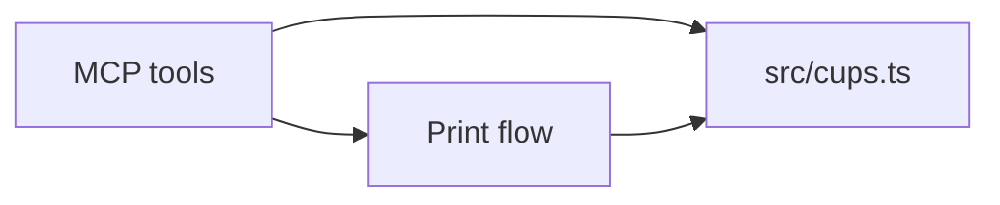

# CUPS access

All contact with CUPS goes through one module, `src/cups.ts`.

## Ownership

- `src/cups.ts` is the only code that talks to CUPS: it submits and cancels jobs, queries printers and queues, and reads and writes the default printer. It also owns turning what CUPS returns into structured values.
- Callers work with printing concepts and never see how CUPS is reached: no command names, arguments, or output formats appear outside the module.
- Changing how CUPS is reached, for example from command-line tools to IPP, changes this module and nothing else.

## Dependency direction

- `src/cups.ts` depends on nothing from the MCP layer, tool schemas, rendering, file access or configuration. It is usable and testable without any of them.
- Policy stays with the callers: which printer a call targets, the copy limit, page confirmation and which settings apply are decided before `src/cups.ts` is called. It carries out what it is given.
- Logic that turns structured printer options into tool values, such as the settings and JIS size rules, runs no processes and is independent of how CUPS is reached.

## Failure semantics

- Operations that only enrich a result, such as reading a printer's options, fail soft. The caller receives "unavailable" and carries on; one unreachable printer does not fail a listing or a print.
- Operations that print or change state, such as submitting or cancelling a job and setting the default printer, fail loudly with CUPS's reason. They are never retried or reported as success.
